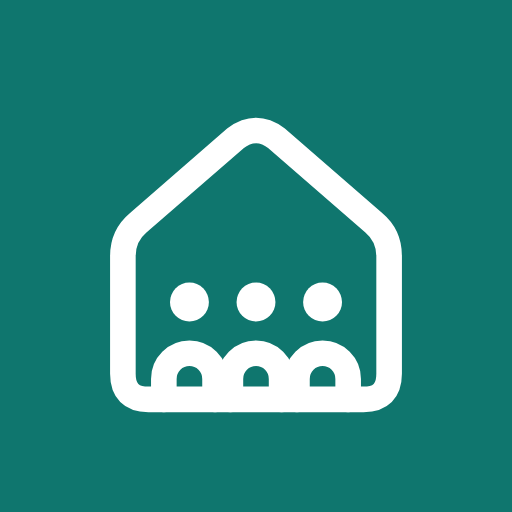
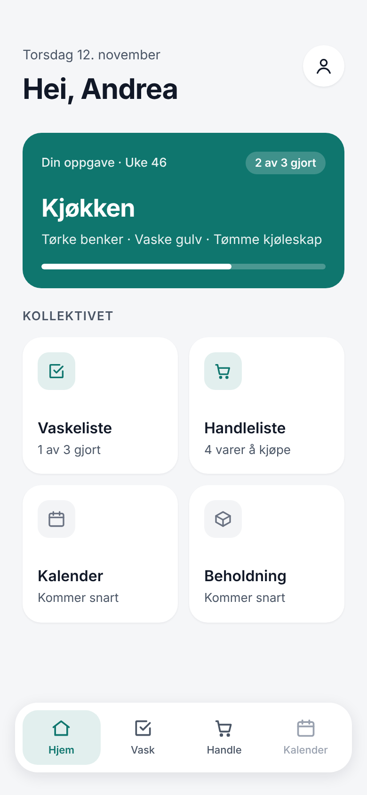
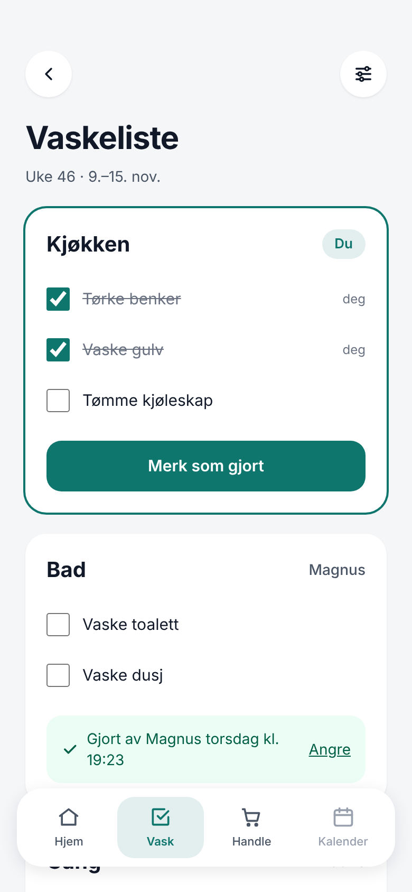
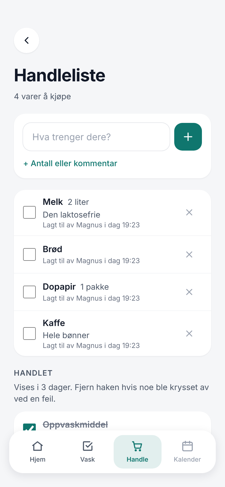
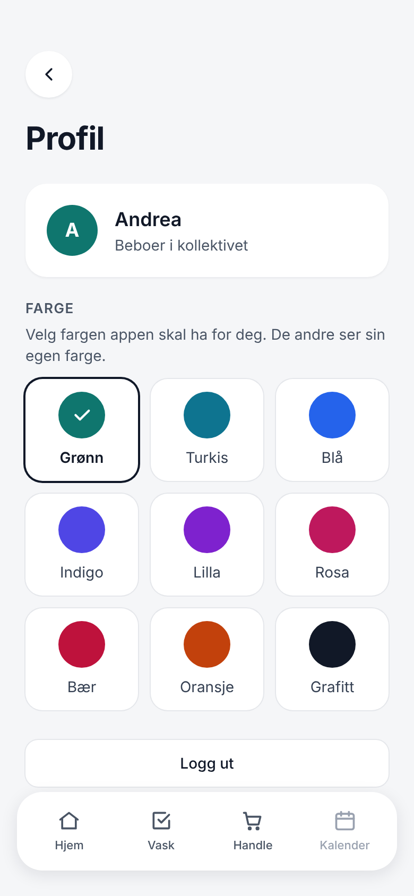

<p align="center">
  
</p>

<h1 align="center">Kollektivet</h1>

<p align="center">
  En felles app for kollektivet: hvem som vasker hva, hva som må kjøpes, og hvem som har gjort det.
</p>

---

I et kollektiv er det mye som skal koordineres, og gruppechatten blir fort rotete. Kollektivet samler det praktiske på ett sted, så alle beboerne ser den samme oversikten. Det gir færre misforståelser og mindre «hvem skulle egentlig vaske badet?».

Appen er laget for mobil, kan legges på hjemskjermen som en vanlig app, og brukes foreløpig av vårt eget kollektiv.

## Skjermbilder

<p align="center">
  
  
  
  
</p>

## Funksjoner

### 🧽 Vaskeliste
- **Ansvarsområder** (kjøkken, bad, gang …) som roterer automatisk mellom beboerne hver uke, annenhver uke eller hver tredje uke.
- **Avkrysning som alle ser:** «Merk som gjort» per område, med hvem som gjorde det og når.
- **Valgfri huskeliste** per område, for eksempel «tørke benker» og «vaske gulv».
- **Enkeltuker kan overstyres:** gi uka til noen andre, eller sett «Ingen vask» når alle er borte.
- **Oversikt over de kommende ukene**, så man kan planlegge.

### 🛒 Handleliste
- **Én felles liste** der varer kan ha antall og kommentar («2 liter, den laktosefrie»).
- **Kryss av når noe er kjøpt.** Varen flyttes til «Handlet» med hvem som kjøpte den, og kan angres.
- **Forslag fra tidligere varer** mens du skriver, de mest brukte først.
- **Stopper dobbeltføringer**, så det samme ikke står på lista to ganger.

### 🎨 Profil og farger
- Hver beboer velger **sin egen farge** for appen, blant ni farger.
- «Logg ut» ligger også her.

### 🔜 Kommer
- **Kalender:** felles hendelser, besøk og bortreiser.
- **Beholdning:** oversikt over felles forbruksvarer.

## Innlogging og sikkerhet
- Man registrerer seg med **navn**, en **firesifret PIN** og en **felles invitasjonskode**, så bare kollektivet kommer inn.
- PIN-koden lagres aldri i klartekst, men hashet med scrypt.
- Etter **5 feil forsøk** låses kontoen i 15 minutter.
- Man holdes innlogget i **30 dager**. Innloggingen lagres i databasen, så «Logg ut» virker med en gang.

## Teknologi

| Del | Valg |
|---|---|
| Rammeverk | [Next.js 16](https://nextjs.org) (App Router, Server Actions) + TypeScript |
| Styling | [Tailwind CSS 4](https://tailwindcss.com) |
| Database | SQLite lokalt, [Turso](https://turso.tech) i produksjon |
| ORM | [Drizzle](https://orm.drizzle.team) |
| Pakkebehandler og tester | [Bun](https://bun.sh) |
| Hosting | [Vercel](https://vercel.com) |

## Kom i gang lokalt

Du trenger [Bun](https://bun.sh) og Git.

```bash
git clone https://github.com/andreaudnaes/kollektivet_v2.git
cd kollektivet_v2
bun install
cp .env.example .env.local   # sett INVITE_CODE til noe eget
bun run db:migrate           # lager tabellene i local.db
bun run dev
```

Åpne http://localhost:3000 og registrer deg med navn, en firesifret PIN og invitasjonskoden fra `.env.local`.

### Miljøvariabler

| Variabel | Beskrivelse |
|---|---|
| `DATABASE_URL` | `file:local.db` lokalt, eller `libsql://…` for Turso |
| `DATABASE_AUTH_TOKEN` | Token fra Turso. Trengs bare i produksjon |
| `INVITE_CODE` | Koden nye beboere må oppgi for å registrere seg |

## Database og migreringer

Databaseskjemaet ligger i `src/db/schema.ts`. Ved endringer:

```bash
bun run db:generate   # lager en ny migreringsfil i drizzle/
bun run db:migrate    # kjører den mot den lokale databasen
```

**I produksjon** må migreringen kjøres mot Turso *før* koden som trenger den legges ut. Ellers krasjer sidene som bruker de nye tabellene:

```bash
git pull
DATABASE_URL="libsql://..." DATABASE_AUTH_TOKEN="..." bun run db:migrate
```

Alt må stå på én linje. Ellers kjøres migreringen mot den lokale fila i stedet for Turso.

## Deploy

Appen ligger på Vercel og legges ut automatisk ved hver push til `main`. Miljøvariablene over er satt i Vercel-prosjektet.

## Scripts

| Kommando | Hva den gjør |
|---|---|
| `bun run dev` | Starter utviklingsserveren |
| `bun run build` | Bygger appen for produksjon |
| `bun run lint` | Sjekker koden med ESLint |
| `bun test` | Kjører testene |
| `bun run db:generate` | Lager en ny migrering fra `src/db/schema.ts` |
| `bun run db:migrate` | Kjører migreringer mot databasen |
| `bun run db:studio` | Åpner Drizzle Studio for å se på dataene |

## Mappestruktur

```
src/
  app/
    (auth)/        Innlogging og registrering
    (app)/         Sider for innloggede, med bunnmeny
      page.tsx       Forsiden
      vaskeliste/    Vaskeliste og innstillinger
      handleliste/   Handleliste
      profil/        Profil og fargevalg
    manifest.ts    Navn og ikon for hjemskjermen
  components/      Felles komponenter, ikoner og bunnmeny
  db/              Databaseklient og skjema (Drizzle)
  lib/             Innlogging, uker, rotasjon, farger og datahenting
  proxy.ts         Sender uinnloggede til /logg-inn
drizzle/           Migreringer
docs/skjermbilder/ Skjermbildene i denne README-en
```

<details>
<summary><strong>Detaljer for utviklere</strong></summary>

- **Rotasjon:** hvem som har ansvaret en uke, regnes ut fra startuka, rekkefølgen og intervallet. Det trengs ingen jobb som «roterer». Uker identifiseres med mandagens dato, i norsk tid. Logikken ligger i `src/lib/rotation.ts` og `src/lib/weeks.ts`, med tester i `src/lib/rotation.test.ts`.
- **Farger:** valgt farge settes som CSS-variabelen `--accent` i `src/app/layout.tsx`. I Tailwind brukes `bg-accent`, `text-accent` og `bg-accent-tint`. Fargelista ligger i `src/lib/colors.ts`.
- **Design:** felles stiler ligger i `src/components/ui.tsx`. Endrer du noe der, endres hele appen.
- **App-ikon:** `src/app/icon.svg` (fane), `src/app/apple-icon.png` (iPhone) og `public/icon-192.png` / `icon-512.png` (Android).
- **Next.js 16:** denne versjonen har endringer som ikke alltid stemmer med eldre dokumentasjon. Se `AGENTS.md` og dokumentasjonen i `node_modules/next/dist/docs/`.

</details>
